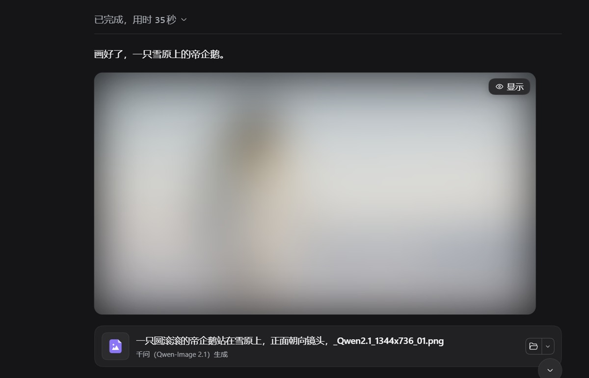
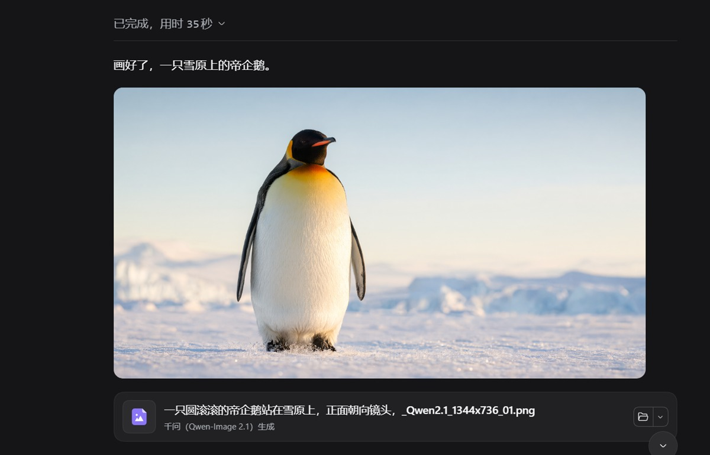

# dsh-image-blur

English | [中文](README.md)

> **A DSH plugin**: every image in the conversation starts blurred — click **Show** in its corner to reveal it.
> Conversation body only. Sidebars, right panels, plugin pages and UI icons are left untouched.


---

## Preview

**Default: blurred.** The image is covered as soon as it appears, with a **Show** button in its top-right corner:



**After clicking Show.** The image is clear; the button fades out, comes back on hover, and covers the image again when clicked:



Both screenshots are from a real DSH conversation window (the picture was generated locally by the Qwen model).

## Features

- **Blurred by default, revealed on demand** — every image starts blurred with a Show / Blur button in its corner; clicking the image itself also reveals it.
- **Conversation only** — the scope is the conversation body, so images elsewhere (plugin icons, panel previews, settings artwork) are never touched.
- **Blur that stays inside the image** — clipped to the image's own border box and radius, with no halo bleeding outside it.
- **No flash of the bare image** — when you switch sessions or a reply streams in, new images are blurred from their first frame.
- **A corner button that keeps up** — it follows scrolling frame by frame, and hides together with the image once the corner is clipped or scrolled out of view.
- **Zero network** — purely local rendering: no requests, no image content is read, and the files themselves are never modified.

## Install

Requires **DSH 0.2 or newer**. Published on npm as `dsh-image-blur`.

### DSH Desktop

**Use the app**: Settings → Plugins → Install, then search for `dsh-image-blur` (or paste `dsh-image-blur@latest`). The desktop app owns its profile, so installing in-app is the reliable path.

With a `dsh` CLI on your PATH, the equivalent command is:

```powershell
dsh plugin --profile desktop add dsh-image-blur@latest --registry=https://registry.npmjs.org/
```

> Note: on a machine running DSH Desktop, `dsh plugin --profile web …` installs into `profiles/web` and **does not** show up in the desktop app. Use the `desktop` profile name there, or install in-app.

### dsh web / self-hosted

```powershell
dsh plugin --profile web add dsh-image-blur@latest --registry=https://registry.npmjs.org/
```

Replace `web` with your own profile name.

Then **restart DSH** (the same applies when an in-app install reports `restart-required`) and **hard-refresh the browser** (`Ctrl+Shift+R`).

<details>
<summary><b>Ask an agent to install it</b></summary>

Send this to any agent that can run local commands:

```text
Install the dsh-image-blur plugin from the official npm registry:
  dsh plugin --profile <profile> add dsh-image-blur@latest --registry=https://registry.npmjs.org/
Then remind me to restart DSH and hard-refresh the browser (Ctrl+Shift+R).
```

</details>

**Update** — re-run the install command (or use *Check for updates* in the market's Installed view), then hard-refresh.
**Uninstall** — remove `dsh-image-blur` under Settings → Plugins (or in the market's Installed view).

> Install / uninstall / update boundaries follow the official document: [`docs/install-and-uninstall.md`](https://github.com/anywhere-labs/dsh-desktop/blob/master/dsh-community-market/docs/install-and-uninstall.md).

## Usage

| Action | Result |
|---|---|
| Click **Show** in the corner | The image becomes clear; the button turns into **Blur** |
| Click **Blur** | Covers the image again |
| Click a blurred image directly | Reveals it (that click does not also open the host's image viewer) |
| Click the image again after revealing | Normal host behaviour (a new image in the viewer is blurred by default too) |

State is remembered per `src`, so switching sessions or re-rendering never re-blurs an image you already revealed. On compact attachment thumbnails the button shrinks to a small eye icon so it does not cover the picture.

## Settings

**Settings → General → Image blur**:

| Item | Description |
|---|---|
| Master switch | Turning it off stops all intervention (attributes and buttons are removed) |
| Strength | Blur radius: low 10px / medium 20px / high 36px |

Stored in `localStorage` under the key `dsh-image-blur:settings:v1`:

| Field | Default | Description |
|---|---|---|
| `enabled` | `true` | Master switch |
| `strength` | `"normal"` | `light` / `normal` / `strong` |
| `minPx` | `120` | Rendered-width threshold for large images (pixels) |

## Which images are affected

An image must satisfy both the *place* and the *size* rule:

- **Place** — inside the conversation body (message flow and composer area).
- **Size** — either:
  - large image: rendered width ≥ `minPx` (default 120) and rendered height ≥ 48;
  - thumbnail: source ≥ 200×200 and rendered ≥ 56×56 (compact cells of multi-image attachments).

Icons, status dots and 1px spacer images are excluded.

### Opting an image out

Add an attribute to the `` or any ancestor:

```html

<div data-dsh-imgblur-skip></div>
```

## How it works

The bundle has two halves: the Host half is an empty implementation, all logic lives in the browser half.

1. **Scope** — a zero-size anchor is mounted in `conversation.chat.turnTail` and another in `conversation.composer.dock`; their lowest common ancestor is treated as the conversation body. Anchors are registered in `useLayoutEffect`, so they exist before the first paint.
2. **Blur** — each `` gets our own attribute `data-dsh-imgblur`; a stylesheet applies `filter: blur()` and clips the result with `clip-path: inset(0 round <the image's own radius>)`. The DOM structure, `className` and `style` are never touched, so host re-renders cannot trip over an extra wrapper.
3. **No first-frame flash** — new `` nodes are registered synchronously inside the `MutationObserver` callback (a microtask, before paint), with a `[data-dsh-imgblur-scope]` CSS pre-blur as a fallback.
4. **Button** — a click-through layer in the `shell.overlay` slot positions one chip per image, frame by frame; visibility is decided by intersecting clipping rects plus an `elementFromPoint` hit test.

## Repository layout

```
dsh-image-blur/
├─ package.json         dsh.bundle.patch + dsh.client{platform:web, immediately:true}
├─ cordis.patch.yml     host row: image-blur
├─ index.js             host half (empty implementation)
├─ client.js            browser half: scope / eligibility / styles / overlay chip / settings row
├─ locale/{zh,en}.json  plugin display name and description
├─ icon.svg             plugin icon
├─ docs/                before/after screenshots used by both READMEs
├─ README.md            Chinese
└─ README.en.md         English (this file)
```

## Troubleshooting

| Symptom | Fix |
|---|---|
| Nothing is blurred at all | Make sure the plugin is enabled (Settings → Plugins) and **fully quit and reopen DSH**; then check the master switch |
| Chat images stay clear but images elsewhere are blurred | The scope anchors are missing — check that `conversation.chat.turnTail` / `conversation.composer.dock` still contain `image-blur-anchor-*` |
| Want smaller images blurred too | Lower `minPx` in `localStorage` and refresh the page |
| The button is offset | Can happen inside a container with a `transform`; adjusting the `order` of the `shell.overlay` registration usually helps |
| Images in the viewer are still blurred | By design: every newly rendered image starts blurred — click its own Show button |

## Known limitations

- **No content detection** — images are treated uniformly; nothing is classified as sensitive or safe.
- Remote images (Markdown `http(s)` links) inside the conversation and large enough are blurred as well.
- On images taller than the viewport, the corner button scrolls out of view together with the image's top-right corner.
- Depends on DSH slots and the `/api/file` image pipeline; if something breaks after a host upgrade, check item 2 of the troubleshooting table first.

## Development

Plain ESM, no dependencies, no build step. After editing `client.js`, refresh the page; host-side changes need a DSH restart.

```bash
node --check client.js
node --check index.js
```

## License

MIT
