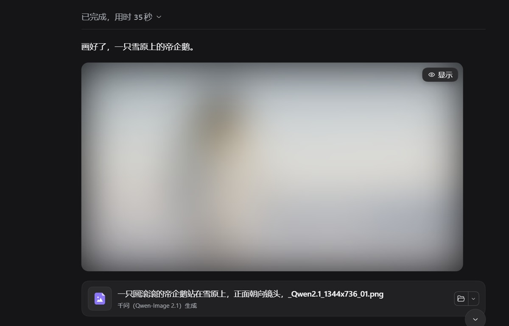
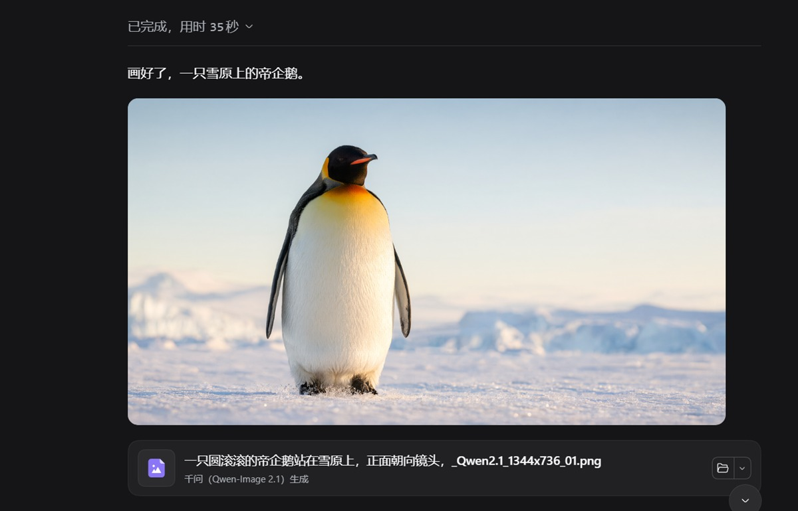

# dsh-image-blur

> **DSH 插件**：对话里的图片默认盖一层模糊，点图片右上角的「显示」才看清。
> 只在会话正文生效 —— 侧栏、右侧面板、插件页面、界面图标都不受影响。


---

## 效果

**默认：模糊。** 图片一出现就糊住，右上角一颗「显示」按钮：



**点「显示」之后。** 图片清晰；按钮淡出，鼠标移上去会重新出现，点它即可盖回去：



两张图截自 DSH 对话窗口（图片由本机千问模型生成）。

## 功能

- **默认模糊，按需揭开**：图片出现即模糊，右上角有一颗「显示 / 模糊」按钮；点图片本身也能直接揭开。
- **只在对话里**：判定基于会话正文容器，聊天区以外的图片（插件图标、面板预览、设置页插图）完全不碰。
- **不外溢的模糊**：裁剪到图片自身的边框与圆角，不会在图片周围晕出一圈。
- **不闪裸图**：切换会话、流式输出时，新图片从第一帧就是模糊的。
- **按钮跟手**：随滚动逐帧跟随；图片被裁掉或滚出可见区域时按钮一起收起，不会浮在对话区外面。
- **零网络**：纯本地渲染，不发请求、不读图片内容、不改动图片文件。

## 安装

需要 **DSH 0.2 及以上**。包已发布到 npm：`dsh-image-blur`。

```powershell
dsh plugin --profile web add dsh-image-blur@latest --registry=https://registry.npmjs.org/
```

- 把 `web` 换成你自己的 profile 名（桌面版一般是 `desktop`）；
- 装完**重启 DSH**，再**硬刷新浏览器**（`Ctrl+Shift+R`）。

社区市场的「可安装」还要求这个包出现在你添加的目录来源里；直接跑上面这条命令不受这个限制。

<details>
<summary><b>让 Agent 帮你装</b></summary>

把下面这段发给任意能执行本地命令的 Agent：

```text
Install the dsh-image-blur plugin into my DSH <profile> profile from the official npm registry:
  dsh plugin --profile <profile> add dsh-image-blur@latest --registry=https://registry.npmjs.org/
Then remind me to restart DSH and hard-refresh the browser (Ctrl+Shift+R).
```

</details>

**更新**：重跑安装命令（或市场「已安装」视图里的 Check for updates），然后硬刷新。
**卸载**：设置 → 插件（或市场「已安装」视图）里移除 `dsh-image-blur`。

> 安装/卸载/更新的边界以官方文档为准：`dsh-community-market` 的 [`docs/install-and-uninstall.zh.md`](https://github.com/anywhere-labs/dsh-desktop/blob/master/dsh-community-market/docs/install-and-uninstall.zh.md)。

## 使用

| 操作 | 效果 |
|---|---|
| 点右上角「显示」 | 图片变清晰，按钮变成「模糊」 |
| 点「模糊」 | 重新盖回去 |
| 直接点模糊的图片 | 揭开（这一次点击不会同时打开宿主自带的看图层） |
| 揭开后再点图片 | 走宿主原本的逻辑（看图层里的新图片同样默认模糊） |

同一张图（相同 `src`）只记一次状态，切换会话或重渲染不会又糊上。多图附件的缩略图上，按钮会缩成一个小眼睛图标，不遮图。

## 设置

**设置 → 通用 → 图片模糊**：

| 项 | 说明 |
|---|---|
| 总开关 | 关掉后不介入任何图片（属性与按钮全部撤销） |
| 强度 | 轻 10px / 中 20px / 强 36px 的模糊半径 |

配置存放在 `localStorage`，键 `dsh-image-blur:settings:v1`：

| 字段 | 默认 | 说明 |
|---|---|---|
| `enabled` | `true` | 总开关 |
| `strength` | `"normal"` | `light` / `normal` / `strong` |
| `minPx` | `120` | 大图的渲染宽度门槛（像素） |

## 哪些图片会被处理

同时满足「位置」与「尺寸」两条才会模糊：

- **位置**：位于会话正文容器内（消息流与输入区）。
- **尺寸**：满足其一即可
  - 大图：渲染宽度 ≥ `minPx`（默认 120）且渲染高度 ≥ 48；
  - 缩略图：原图 ≥ 200×200 且渲染 ≥ 56×56（多图附件的紧凑格子走这条）。

图标、状态点、1px 占位图都会被排除。

### 排除某张图

给 `` 或它的任意祖先加一个属性即可：

```html

<div data-dsh-imgblur-skip></div>
```

## 工作原理

插件由两半组成：宿主半边为空实现，全部逻辑在浏览器半边。

1. **定位作用域**：在 `conversation.chat.turnTail` 与 `conversation.composer.dock` 各挂一个零尺寸锚点，取二者的最近公共祖先作为「会话正文容器」；锚点用 `useLayoutEffect` 登记，保证在绘制前就位。
2. **模糊**：给 `` 加自有属性 `data-dsh-imgblur`，由样式表下发 `filter: blur()`，并用 `clip-path: inset(0 round <图片自身的圆角>)` 裁回图片边界。**不改 DOM 结构、不动 `className` / `style`**，所以宿主重渲染时不会因为多余的包裹层报错。
3. **首帧不闪**：`MutationObserver` 回调（微任务，早于绘制）里同步登记新增的 ``；容器另有 `[data-dsh-imgblur-scope]` 的 CSS 预糊兜底。
4. **按钮**：在 `shell.overlay` 槽渲染一层穿透浮层，逐帧按图片矩形定位；可见性用「裁剪矩形交集 + `elementFromPoint` 命中测试」判定。

## 目录结构

```
dsh-image-blur/
├─ package.json        dsh.bundle.patch + dsh.client{platform:web, immediately:true}
├─ cordis.patch.yml    宿主行：image-blur
├─ index.js            宿主半边（空实现）
├─ client.js           浏览器半边：作用域 / 判定 / 样式 / 浮层按钮 / 设置行
├─ locale/{zh,en}.json 插件显示名与描述
├─ icon.svg            插件图标
├─ docs/               效果对比图（README 用）
└─ README.md
```

## 排障

| 现象 | 处理 |
|---|---|
| 图片完全没被处理 | 确认插件已启用（设置 → 插件），并**彻底退出 DSH 重开**；再检查设置里的总开关 |
| 聊天里的图没糊，别处糊了 | 作用域锚点没挂上：检查 `conversation.chat.turnTail` / `conversation.composer.dock` 里是否还有 `image-blur-anchor-*` |
| 想糊更小的图 | 把 `minPx` 调小（localStorage），刷新页面 |
| 按钮位置偏了 | 图片位于带 `transform` 的容器内时可能出现，调整 `shell.overlay` 注册项的 `order` 可缓解 |
| 看图层里的图还是糊的 | 这是设计：新出现的图片一律默认模糊，点它自己的「显示」 |

## 已知限制

- **不做内容识别**：不判断图片是否少儿不宜，所有够大的图片一视同仁。
- 远程图片（Markdown 里的 `http(s)` 链接）只要在会话正文内且够大，同样会被模糊。
- 比视口还高的长图，滚到中段时按钮会随图片右上角一起移出可见区。
- 依赖 DSH 的槽位与 `/api/file` 图片渲染路径，升级内核后若出现异常，优先看排障第 2 条。

## 开发

纯 ESM、零依赖、无构建步骤。改完 `client.js` 后刷新页面即可；宿主侧改动需重启 DSH。

```bash
node --check client.js
node --check index.js
```

## 许可

MIT
